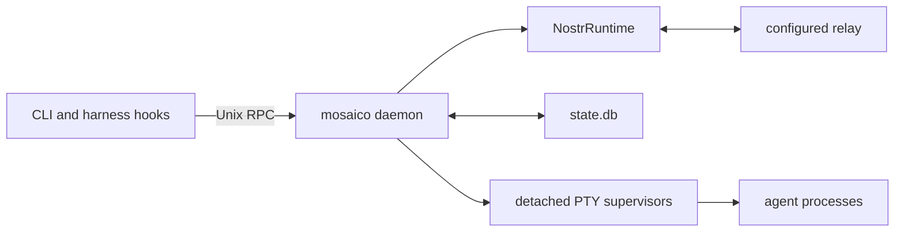

# Daemon design

The daemon is the single owner of local Mosaico coordination. Harness hooks and
CLI clients are thin RPC clients; detached PTY supervisors are independent
processes that the daemon can re-adopt after restart.

## Process topology

Each selected instance has exactly one daemon, guarded by its startup lock and
Unix socket. The daemon owns:

- the current configuration and backend key;
- one Nostr runtime and one decoded NIP-29 view;
- one SQLite connection behind the daemon store lock;
- live session engines and their runtime generations;
- subscription coverage and product reconcilers;
- RPC routing, inbox delivery, and tail events.

The daemon and PTY supervisors are the same executable invoked with different
subcommands. A normal restart therefore stops only the `mosaico daemon`
process. It must never kill by bare executable name. On systemd,
`KillMode=process` preserves detached supervisors.

## Nostr runtime

The daemon constructs one `NostrRuntime` for the configured relay. It owns the
only `nostr-sdk` client, relay connection, bounded in-memory raw event database,
SDK subscription ids, and notification task. Product code never owns sockets
or opens an independent client.

The decoded `Nip29View` is a complete process-local level derived from active
filters. Notifications wake a full reread; they are never applied as deltas.
The view starts empty on every daemon start and cannot fall back to SQLite.
See [fabric-architecture.md](fabric-architecture.md) for exact ownership,
demand limits, signing, and acknowledgement rules.

## Session lifecycle

A session is identified by its Nostr pubkey. A runtime generation fences stale
callbacks and ensures only the current engine can mutate lifecycle state.
Durable session rows contain execution continuity—not relay state—including:

- agent/harness identity and workspace root;
- encrypted or derived signer custody;
- active runtime generation and native locator;
- local channel routes and join fences;
- semantic state, idle deadlines, and accumulated busy time.

Starting or re-adopting a session reopens the product demands implied by local
coverage. Channel readiness verifies the current relay-derived group view and,
when authorized, publishes the minimum required NIP-29 management operations
with the backend key. The local route is committed only after the corresponding
management operation receives a positive relay acknowledgement.

Stopping a session ends local execution but does not silently rewrite relay
membership. Explicit leave/revocation paths own member removal. Their local
standing ledgers make those product actions recoverable without storing signed
events or creating a generic outbox.

## Subscription and view flow

Coverage is recomputed from local sessions, explicit roots, known managed
groups, and current decoded rosters. The reconciler produces stable product
demands:

- one broad `h` demand for chat, reactions, status, and addressed management
  commands;
- one bounded group-record demand;
- one exact-author profile demand.

Each product demand keeps a stable id, but every REQ for it gets a fresh SDK
subscription id (`<demand>:<sequence>`). Changing coverage opens the
replacement first and only then closes the old subscription. Relays may apply
one connection's frames concurrently, so reusing an id would let a late CLOSE
drop the new subscription. Completion (EOSE) state is pruned to live and
opening subscriptions whenever one closes. If a replacement is refused, the old
subscription keeps serving the demand. One view-rebuild task queries all active
filters and atomically swaps the decoded level. Demux, read/search RPCs,
channel readiness, presence, and profile resolution reread that level after
wakes.

No application retained-handle abstraction exists. A few serialized one-shot
reads open a stable temporary demand for an exact profile, group, or reference
question, then close it; like every demand, each read's REQ uses a fresh SDK
subscription id.

## Inbound delivery

Observed events flow through one demux:

1. read the complete content level;
2. record the event-id arrival fence before product dispatch;
3. decode product messages, reactions, statuses, and orchestration commands;
4. create local inbox or claim rows only for daemon-owned execution work;
5. wake the exact local session or schedule recovery.

The arrival ledger stores ids and sequence only. Public reads continue to come
from the current NIP-29 view, so a relay removal retracts a message even when a
local idempotency or inbox record remains.

## Outbound flow

Every write begins with an already-selected `Keys` value. Product code finishes
all tags and signs once. The runtime sends to the configured relay and reports:

- accepted: positive `OK` for the exact event id;
- rejected: negative `OK`;
- unconfirmed: timeout, disconnect, AUTH demand, or transport failure.

An accepted write is not inserted into the read view. It must return through an
active subscription before it can drive demux or public reads. Chat, reply,
reaction, group create/edit/delete, and role operations have no background
retry or durable signed-event storage.

Presence and profiles are replaceable desired state. Their daemon-owned workers
may coalesce to the latest desired value and retry within an explicit bound.
That exception is product policy and cannot be generalized to arbitrary events.

## RPC behavior

RPC handlers separate three milestones:

1. local command validation and authority selection;
2. exact relay acknowledgement for writes;
3. later relay observation for shared-state reads and inbound effects.

Handlers must not report milestone 3 merely because milestone 2 succeeded.
Readiness flows may wait for a complete observed group level where their product
contract requires it, but they do not poll or seed a local group/message cache.

Hooks fail open when the daemon is unavailable. Operator commands fail clearly
when the selected daemon or relay cannot complete the requested contract.

## Configuration reload

The daemon watches the selected `config.json`. Non-runtime policy changes swap
the provider configuration. Relay or backend-key changes construct and start a
fresh runtime/view/provider set, atomically install it, reopen coverage, then
shut down the previous SDK client. Invalid edits leave the last valid runtime
in service.

Reload has no publication-store recovery, signer restoration, compatibility
mode, or dual runtime. An old `publications.redb` file is unowned and ignored.

## Shutdown and reset

Normal shutdown:

1. stops accepting RPC connections;
2. asks live session engines to settle;
3. leaves detached PTY supervisors alive unless an explicit destructive reset
   requested their removal;
4. closes product demands and shuts down the SDK client;
5. releases the daemon lock on process exit.

`daemon reset-state` is destructive for current Mosaico continuity: SQLite,
session runtime directories, logs, transient sockets, and attachment contents.
It preserves configuration and ignores files the current architecture does not
own. It audits exact targets before stopping processes or deleting data.

## Non-negotiable invariants

- One daemon writer for local mutable state.
- One SDK client and one raw event database per selected instance.
- One complete decoded product view; no relay-state SQLite replica.
- One exact author per signed event; no signer registry or fallback.
- Positive relay acknowledgement before synchronous write success.
- No generic durable publication queue or signed-event replay.
- No polling for shared semantic state.
- Daemon restart never kills detached supervisors.
