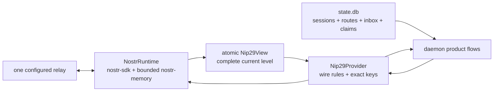

# Fabric architecture: one-page view

See [fabric-architecture.md](fabric-architecture.md) for the complete contract.

## The mental model

**The relay owns shared admission. The SDK runtime owns transport and raw
memory. The NIP-29 view owns current decoded relay state. SQLite owns only
host-local continuity.**

Notifications are wakes, not state changes. Each wake causes an exact-filter
reread from the bounded SDK database and an atomic replacement of the decoded
view. Closing or replacing a demand retracts excluded product values. Restart
starts the view empty and repopulates it from relay subscriptions.

Product writes receive an already-selected backend, operator, or session key.
The provider adds all protocol context and signs once. The runtime sends only
to the configured relay and reports success only for a positive `OK` on the
exact event id. Negative `OK` is rejection; timeout or disconnect is
unconfirmed.

There is no signer registry, durable generic outbox, relay-state SQLite cache,
notification-delta projection, multi-relay router, or compatibility facade.
Presence and profiles may coalesce and retry only because they are replaceable
desired state; chat and management writes never inherit that policy.

Local routes, inbox work, arrival fences, and receipts survive restart because
they are local execution facts. They never prove current relay membership or
resurrect a message removed from the current NIP-29 view.
