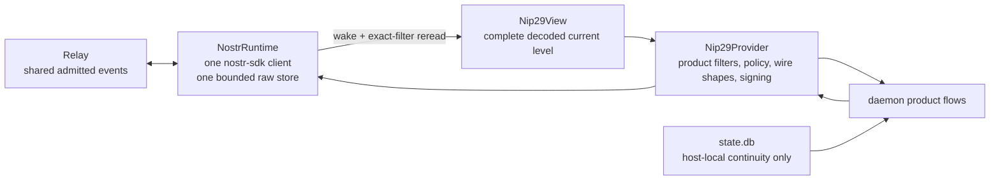

# Mosaico fabric architecture

Mosaico uses one configured Nostr relay as its shared coordination fabric. The
architecture has four owners, each with a deliberately different lifetime.

## Ownership

| Owner | Owns | Explicitly does not own |
|---|---|---|
| Relay | Admission and relay-authored NIP-29 state | Host sessions or filesystem state |
| `NostrRuntime` | One `nostr-sdk` client, one relay connection, SDK subscription ids, reconnect behavior, a bounded `nostr-memory` database, and exact-relay sends | NIP-29 policy, key selection, durable writes, generic retries |
| `Nip29Provider` and `fabric/nip29` | Product demand shapes, NIP-29 encoding/decoding, membership policy, and signing with caller-selected keys | Sockets, connection recovery, key selection, a second raw event store |
| `Nip29View` | One atomically replaced decoded current level | Event history, deltas, persistence, invented absence |
| `state.db` | Sessions, local routes and fences, signer custody, inbox/claims, filesystem bindings, attachment locations, and local receipts | Relay event payloads, group/profile/status/message caches, publication obligations |

This shape is intentionally not a generic Nostr framework. Mosaico has one
product, one relay selection, and one NIP-29 wire contract. Abstractions exist
only where ownership or lifetime changes.

## Reads: complete levels, never notification deltas

The runtime maintains stable product demands:

| Demand | Filter | Bound |
|---|---|---:|
| `mosaico-broad-h` | product kinds plus kind 5 deletion markers for every covered `h` | 4096 |
| `mosaico-group-records` | relay-authored kinds 39000/39001/39002 plus kind 5 deletion markers | 1024 |
| `mosaico-profiles` | kinds 0 and 5 from the current exact author set | 512 |
| bounded reference read | requested kinds referencing one `e` id | 64 |

The `nostr-memory` capacity is derived beside these limits and includes explicit
headroom. It is the only raw event database and disappears on daemon restart.

SDK notifications and EOSE are wakes only. After every relevant wake, demand
change, or NIP-40 expiration deadline, the rebuild task:

1. queries the raw database with every currently active filter;
2. unions events by id;
3. excludes expired events and relies on the SDK database's Nostr
   replacement/deletion rules;
4. decodes content, group records, and profiles; and
5. atomically swaps the complete `Nip29View` and wakes consumers.

Replacing or closing a demand therefore retracts excluded values even if their
raw bytes remain in bounded memory. Consumers cannot apply notification deltas
or retain a previous row. Restart begins with an empty product view and
repopulates it only through reopened relay subscriptions.

Group, profile, status, message, recipient, reply, and reaction reads all use
that complete view. SQLite never fills a missing relay value. Local routes and
inbox rows may determine what this daemon should execute, but they do not prove
that a group, membership, or message currently exists.

## Writes: exact keys and honest relay acknowledgement

The caller selects the exact `Keys` capability from backend, operator, or
session custody. Product code completes the event shape—including every NIP-29
`h` tag—and finalizes it once. The runtime has no signer registry, author
override, fallback identity, or signing retry.

The runtime sends the signed event to the configured relay through the SDK's
typed single-relay API. That path does not save the outbound event into the SDK
database. Outcomes are:

- **accepted** only after a positive `OK` for the exact event id;
- **rejected** after a negative `OK`, with relay text bounded before reporting;
- **unconfirmed** after timeout, disconnect, authentication demand, or transport
  failure.

Chat, reply, reaction, and group-management RPCs return those outcomes
synchronously. There is no generic publication ledger or background replay.
A successful send is still not an observation: the event becomes visible only
if an active read demand receives it from the relay.

Presence and profile are different because they are replaceable desired state.
Their product workers may retain only the newest desired value and make bounded
attempts. They never replay an old signed artifact, and that narrow policy must
not become an outbox for other event types.

## NIP-29 product ownership

`fabric/nip29/wire` owns application event shapes. The adjacent management
module owns kinds 9000, 9001, 9002, 9007, and 9008. Group projection owns
relay-authored kinds 39000, 39001, and 39002. The SDK is transport and storage;
it does not claim NIP-29 support.

The selected product profile is intentionally small:

- one configured relay;
- public reads;
- NIP-29 signed-event write authorization;
- multiple exact author keys;
- no connection-authenticated NIP-42.

If a relay requires AUTH, the operation fails explicitly. Adding NIP-42 would
need a new product decision because authentication is connection-scoped while
Mosaico publishes as multiple identities.

## Local continuity and delivery

`state.db` may retain exact-recipient inbox work, idempotency claims, local
arrival ordering, route admission fences, and downloaded attachment paths.
These are local execution facts, not a relay replica. In particular:

- a route is not proof of current membership;
- an inbox row is not chat history;
- a receipt explains a local operation and is not relay acceptance;
- an attachment path cannot resurrect a removed message.

Direct mentions become durable local inbox work only after the message is
observed in the current relay view. Ambient delivery additionally respects the
local route's signed-time and arrival-sequence fences. A removed relay event
immediately disappears from public read/search/reply surfaces even if a local
execution ledger still refers to its id.

## Lifecycle and configuration reload

Startup constructs an empty view and one runtime, starts the configured relay,
opens product demands from current local coverage, and rebuilds from received
events. Configuration changes that alter relay or backend identity construct
and start a new runtime/view pair before swapping daemon references, then stop
the old SDK client. No legacy store is opened, migrated, reset, or deleted.

Daemon shutdown closes product demands and the SDK client. Restart targets only
the daemon process; detached PTY supervisors survive and are re-adopted.

## Coherence rules

A change violates this architecture if it introduces any of the following:

- another relay client or raw event database;
- persisted relay events or a durable generic outbox;
- notification-delta product state;
- a retained subscription-handle abstraction above the SDK;
- signer lookup, author fallback, or post-sign mutation;
- success before exact positive relay acknowledgement;
- polling for semantic state;
- compatibility aliases for the removed runtime.
